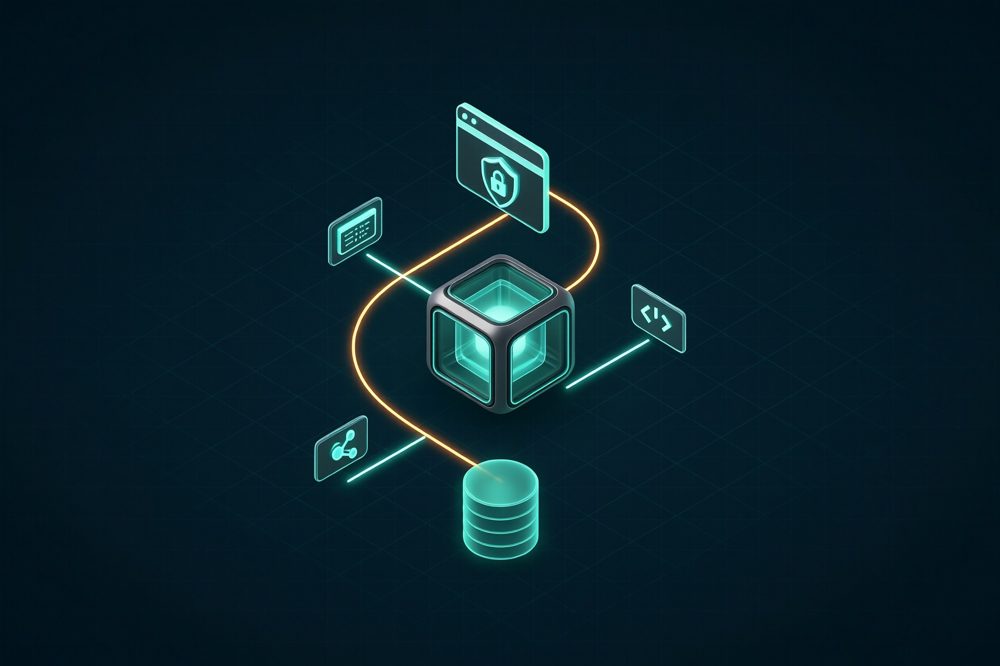
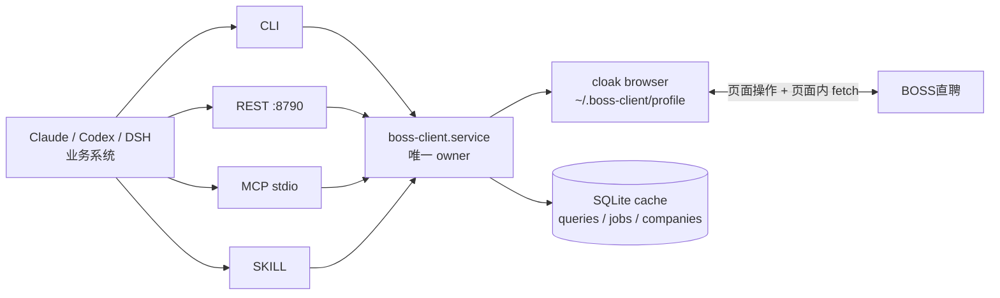
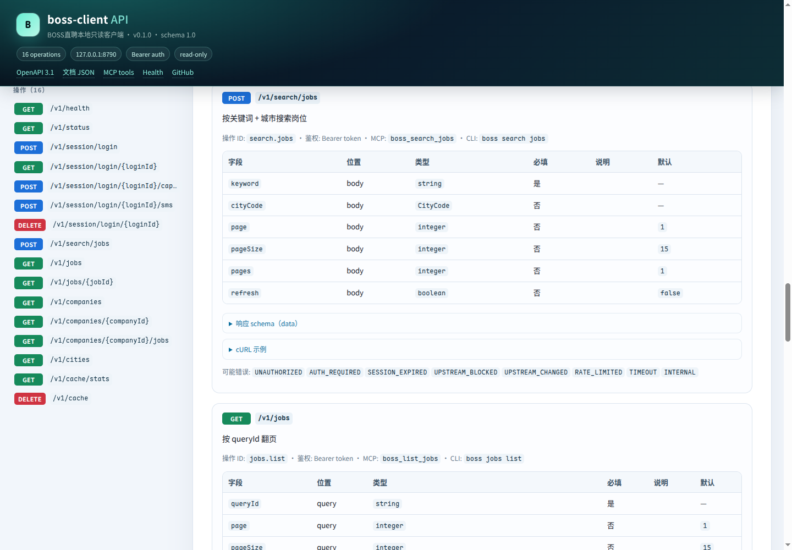

<div align="center">
  
  <h1>boss-client</h1>
  <p><strong>把 BOSS直聘 变成 Agent 可调用的本地只读数据源。</strong></p>
  <p>一套浏览器会话 · 一份结构化缓存 · 一个常驻 owner 进程<br/>通过 <b>CLI</b> / <b>REST</b> / <b>MCP</b> / <b>SKILL</b> 四种形态对外服务。</p>
  <p>
    
    
    
    
    
    
  </p>
</div>

> 本项目与 BOSS直聘官方无关。仅使用本人/授权账号做低频只读查询，不提供沟通、投递、简历修改等写操作；请遵守平台服务条款与当地法律。

## 为什么是 boss-client？

| 🔐 会话留在本地 | 🧠 为 Agent 设计 | 🧱 一个进程做 owner |
| --- | --- | --- |
| cloakbrowser + 独立 profile，登录态、二维码、Cookie 都不出本机；REST 只监听 `127.0.0.1`。 | 16 个稳定操作，统一 envelope、分页、错误码；同时提供 CLI、OpenAPI、MCP tools 和 SKILL。 | systemd 服务是唯一持有浏览器/profile 的 owner；CLI/MCP 都只是客户端，不会互相抢 profile。 |

## 30 秒开始

```bash
git clone https://github.com/CindyRIng/boss-client.git
cd boss-client
npm install && cp .env.example .env
# 编辑 .env：至少设置 BOSS_API_TOKEN
npm run build

ln -sf "$PWD/bin/boss-run" ~/.local/bin/boss
boss login --qr          # 首次登录：终端渲染二维码，用 BOSS App 扫码
boss status              # 登录态 / 会话剩余 / 风控 / 缓存
boss search jobs --keyword 外贸 --city 101090100 --page-size 15 --pages 1
```

> 首次/掉线登录需要人工扫码或短信验证码；之后复用 `~/.boss-client/profile`，实测会话约 10 天。

## 它能做什么

| 能力 | CLI | REST | MCP |
| --- | --- | --- | --- |
| 健康检查 | `boss health` | `GET /v1/health` | `boss_health` |
| 登录态 / 会话 / 风控 | `boss status` | `GET /v1/status` | `boss_status` |
| 登录中继（二维码 / 短信 / 极验） | `boss login` | `POST /v1/session/login*` | `boss_login_*` |
| 岗位搜索 | `boss search jobs` | `POST /v1/search/jobs` | `boss_search_jobs` |
| 岗位翻页 | `boss jobs list` | `GET /v1/jobs` | `boss_list_jobs` |
| 岗位详情 | `boss jobs detail` | `GET /v1/jobs/{jobId}` | `boss_job_detail` |
| 去重公司列表 | `boss companies list` | `GET /v1/companies` | `boss_list_companies` |
| 公司详情（含工商信息） | `boss companies detail` | `GET /v1/companies/{companyId}` | `boss_company_detail` |
| 公司全部职位 | `boss companies jobs` | `GET /v1/companies/{companyId}/jobs` | `boss_company_jobs` |
| 城市注册表 | `boss cities list` | `GET /v1/cities` | `boss_cities` |
| 缓存统计 / 清理 | `boss cache stats/clear` | `GET/DELETE /v1/cache*` | `boss_cache_*` |

## 一张图看懂架构





**关键约束：** 浏览器/profile 只能有一个 owner。常驻服务运行时，CLI 通过 `BOSS_CLIENT_URL` 走 REST，MCP 默认代理到 REST；只有显式 `boss mcp --local` 才会本地启动浏览器。

<details>
<summary><b>展开：运行模式与单实例锁</b></summary>

| 模式 | 适用场景 | 行为 |
| --- | --- | --- |
| 常驻服务 + 客户端（推荐） | Agent、长期使用 | systemd 持有浏览器/profile；CLI/MCP 通过 REST 调用 |
| 单机 CLI | 临时查询、开发 | 没有服务时 CLI 自己启动本地 App |
| MCP `--local` | 无服务的独立调试 | MCP 自己持有 profile；不要和常驻服务同时使用 |

`~/.boss-client/run/boss.lock` 是单实例锁；它能防止两个 Chromium 同时写同一个 `userDataDir`，所以不要删除锁或绕开它。

</details>

## 快速使用

### CLI

```bash
boss status
boss search jobs --keyword 外贸 --city 101090100
boss jobs list --query-id q_20261111_ab12cd --page 2
boss jobs detail --job-id 9b480e5d72caccd303Zz3du6FFFS
boss companies list --query-id q_20261111_ab12cd --fetch-pages 1
boss companies detail --id 'd6c15290231e61e21Hd70965EFY~'
boss companies jobs --id 'd6c15290231e61e21Hd70965EFY~'
```

默认输出统一 envelope JSON；`boss --format table ...` 输出简表。需要管道时：

```bash
BOSS_LOG_STDOUT=false boss status | jq .
```

### REST

```bash
boss serve --port 8790
# 交互文档 / OpenAPI
# 浏览器打开 http://127.0.0.1:8790/docs
curl http://127.0.0.1:8790/openapi.json

# 除 /v1/health 外需要 Bearer
curl -H "Authorization: Bearer $BOSS_API_TOKEN" \
  http://127.0.0.1:8790/v1/status

curl -X POST http://127.0.0.1:8790/v1/search/jobs \
  -H "Authorization: Bearer $BOSS_API_TOKEN" \
  -H 'content-type: application/json' \
  -d '{"keyword":"外贸","cityCode":"101090100","page":1,"pageSize":15,"pages":1}'
```



<p align="center"><sub>自包含 REST 文档：操作索引、字段表、响应 schema、cURL 示例、错误码 · <a href="http://127.0.0.1:8790/docs">/docs</a></sub></p>

### MCP

MCP 进程**不持有浏览器**，默认代理到常驻 REST 服务：

```json
{
  "mcpServers": {
    "boss-client": {
      "command": "/path/to/boss-client/bin/boss-run",
      "args": ["mcp"],
      "env": {
        "BOSS_CLIENT_URL": "http://127.0.0.1:8790",
        "BOSS_API_TOKEN": "change-me"
      }
    }
  }
}
```

```bash
boss mcp              # 默认代理；服务未启动时返回 SERVICE_UNAVAILABLE
boss mcp --proxy      # 显式代理
boss mcp --local      # 无服务时本地运行；不要与常驻服务同时用
```

工具清单见 [`spec/mcp-tools.json`](spec/mcp-tools.json)，SKILL 见 [`skills/boss/SKILL.md`](skills/boss/SKILL.md)。

## 安装与登录

<details>
<summary><b>展开：完整安装、登录和环境要求</b></summary>

### 前置

- Linux（已在 NixOS 26.11 验证）；Node.js ≥ 22.5；FHS 内 Node 22.23.2
- `~/cloak-env`：共享 cloakbrowser FHS 环境，见 [docs/04-环境配套.md](docs/04-环境配套.md)
- 一个可登录 BOSS直聘的求职者账号
- 登录/短信极验需要 headful（桌面或 Xvfb）；二维码模式可 headless

```bash
~/cloak-env/bin/cloak-env-info
```

### 安装

```bash
git clone https://github.com/CindyRIng/boss-client.git
cd boss-client
npm install
cp .env.example .env
# 至少设置 BOSS_API_TOKEN；短信登录再设置 BOSS_PHONE
npm run build && npm test && npm run gen

ln -sf "$PWD/bin/boss-run" ~/.local/bin/boss
boss health
```

### 登录（首次/掉线人工一次）

```bash
# 推荐：headless 下直接输出二维码
boss login --qr
boss login --relay     # 只输出 LoginSession（含 qr.pngBase64），适合远程 Agent

# 短信：需要 headful
BOSS_HEADLESS=false boss login --sms
```

短信/极验无法可靠自动破解；二维码模式不需要可视浏览器。登录成功后 profile 持久化，`boss status` 应显示 `loggedIn=true`。

</details>

## 配置

完整变量见 [`.env.example`](.env.example) 与 [docs/03-部署与使用.md](docs/03-部署与使用.md)。

| 变量 | 默认 | 说明 |
| --- | --- | --- |
| `BOSS_API_TOKEN` | `change-me` | REST/MCP Bearer，部署必须修改 |
| `BOSS_PHONE` | 空 | 短信登录手机号 |
| `BOSS_PROFILE_DIR` | `~/.boss-client/profile` | 独立浏览器 profile |
| `BOSS_CACHE_DB` | `~/.boss-client/cache.db` | SQLite 结构化缓存 |
| `BOSS_HEADLESS` | `true` | 默认无头；二维码扫码可用；短信/极验需临时 false |
| `BOSS_PORT` | `8790` | REST 端口（本机 tanji 占用 8787–8789） |
| `BOSS_CLIENT_URL` | 空 | CLI/MCP 代理的 REST 地址；缺省按 host/port 推导 |
| `BOSS_CITIES` | `101090100` | 默认城市码，逗号分隔多城市 |
| `BOSS_RATE_PER_MIN` | `12` | 上游请求/分钟 |
| `BOSS_MAX_PAGES` | `5` | 单任务最多页数 |

## 部署

```bash
mkdir -p ~/.config/systemd/user
cp systemd/boss-client.service ~/.config/systemd/user/
systemctl --user daemon-reload
systemctl --user enable --now boss-client
systemctl --user status boss-client
```

服务默认读取 `%h/boss-client/.env`，执行 `bin/boss-run serve --port 8790`。日志：`journalctl --user -u boss-client -f`。

## 项目结构

<details>
<summary><b>展开目录</b></summary>

```text
src/
  api/            操作注册表 + dispatch（单一事实源）
  adapters/boss/  端点、页面内 API、DOM 提取、映射、限频
  browser/        cloak 浏览器宿主
  cache/          SQLite / 内存缓存
  config/         配置
  domain/         zod 领域模型
  generators/     OpenAPI / MCP / CLI / schema 生成
  session/        会话 / 登录中继 / 心跳
  transports/     REST / CLI / MCP
  service.ts      服务层
tests/            单元测试（无浏览器）
spec/             生成物（openapi.json / mcp-tools.json / schemas / operations）
docs/             PRD、接口草案、部署、环境配套
skills/boss/      SKILL
systemd/          systemd user unit
exploration/      2026-11-11 实测记录（artifacts 不入库）
```

</details>

## 安全与合规

- REST 仅 `127.0.0.1` + Bearer；profile/cache/log 权限 600/700。
- 二维码、验证码、短信码、Cookie、token 不落长期日志；登录中继仅本机。
- 只读；低频；单账号；不做账号共享、批量导流或自动化投递。
- 请遵守 BOSS直聘用户协议与当地法律；因使用产生的账号/合规风险由使用者承担。

## 文档

| 文档 | 内容 |
| --- | --- |
| [文档索引](docs/README.md) | 全部文档的入口与推荐阅读顺序 |
| [01 需求文档](docs/01-需求文档.md) | 目标/非目标、架构、功能需求、缓存、验收 |
| [02 接口草案](docs/02-接口草案.md) | envelope、错误码、数据模型、操作契约、SQLite |
| [03 部署与使用](docs/03-部署与使用.md) | 安装、配置、登录、CLI/REST/MCP、systemd、排障 |
| [04 环境配套](docs/04-环境配套.md) | cloak-env/FHS、版本、profile、DISPLAY/Xvfb、权限 |
| [2026-11-11 实测](exploration/2026-11-11/REPORT.md) | 真实登录/搜索/详情/公司页实测与证据索引 |

## License

[MIT](LICENSE) © 2026 CindyRIng
