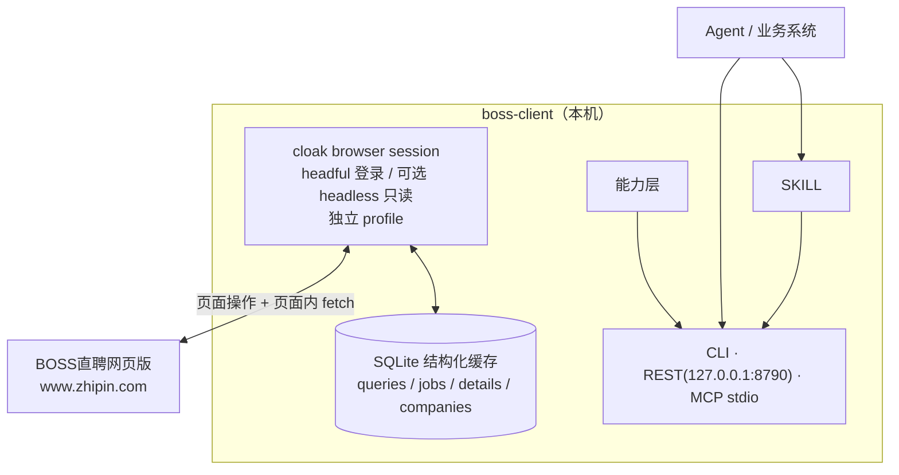

# boss-client

BOSS直聘（网页版）**本地只读客户端**：复用 `cloak-env` 的 cloakbrowser 运行环境与独立 profile 保活登录态，把「岗位搜索 / 岗位详情 / 公司列表 / 公司详情（含工商信息）/ 公司全部职位 / 状态」以 **CLI / REST / MCP / SKILL** 四种形态暴露给 Agent 与业务系统。

> 本项目与 BOSS直聘官方无关；仅使用本人/授权账号做低频只读查询，请遵守平台服务条款。

## 状态

- 2026-11-11 已用非无头 cloakbrowser 在真实账号上实测：二维码获取、短信验证码 + 极验、登录、岗位搜索、翻页、岗位详情、公司详情、公司全部职位、状态检查。
- PRD v0.1：[docs/01-需求文档.md](docs/01-需求文档.md)
- 接口草案 v0.1：[docs/02-接口草案.md](docs/02-接口草案.md)
- 实测记录：[exploration/2026-11-11/REPORT.md](exploration/2026-11-11/REPORT.md)

## 能力

| 能力 | CLI | REST | MCP |
| --- | --- | --- | --- |
| 健康检查 | `boss health` | `GET /v1/health` | `boss_health` |
| 登录态/会话/风控 | `boss status` | `GET /v1/status` | `boss_status` |
| 登录（短信/扫码/极验中继） | `boss login` | `POST /v1/session/login*` | `boss_login_*` |
| 岗位搜索 | `boss search jobs` | `POST /v1/search/jobs` | `boss_search_jobs` |
| 岗位翻页 | `boss jobs list` | `GET /v1/jobs` | `boss_list_jobs` |
| 岗位详情 | `boss jobs detail` | `GET /v1/jobs/{jobId}` | `boss_job_detail` |
| 去重公司列表 | `boss companies list` | `GET /v1/companies` | `boss_list_companies` |
| 公司详情（含工商） | `boss companies detail` | `GET /v1/companies/{companyId}` | `boss_company_detail` |
| 公司全部职位 | `boss companies jobs` | `GET /v1/companies/{companyId}/jobs` | `boss_company_jobs` |
| 城市注册表 | `boss cities list` | `GET /v1/cities` | `boss_cities` |
| 缓存统计/清理 | `boss cache stats/clear` | `GET/DELETE /v1/cache*` | `boss_cache_*` |

## 架构



- **浏览器**：复用 `~/cloak-env`（cloakbrowser 0.6.5 + Chromium 146）；使用独立 profile（默认 `~/.boss-client/profile`），不与 tanji-client / fuma 共用。
- **只读**：不沟通、不投递、不改简历、不切换招聘者身份；不写 CRM。
- **结构化缓存**：SQLite，不落 raw 响应/HTML、不存 cookie/token/验证码。

## 快速开始

### 0. 前置

- Linux（已在 NixOS 验证）；Node.js ≥ 22.5（FHS 内为 Node 22.23.2）
- `~/cloak-env`：共享 cloakbrowser FHS 环境（见 [docs/04-环境配套.md](docs/04-环境配套.md)）
- 一个可登录 BOSS直聘的求职者账号
- 桌面显示（登录/验证码需要 headful）；无桌面服务器用 Xvfb

```bash
# 检查 cloak 环境
~/cloak-env/bin/cloak-env-info
```

### 1. 安装

```bash
git clone https://github.com/CindyRIng/boss-client.git
cd boss-client
npm install
cp .env.example .env
# 编辑 .env：至少设置 BOSS_API_TOKEN；短信登录再设置 BOSS_PHONE
npm run build
npm test
npm run gen
```

把 CLI 放到 PATH：

```bash
ln -sf "$PWD/bin/boss-run" ~/.local/bin/boss
# 确认
boss health
```

### 2. 登录（首次/掉线人工一次）

```bash
# 默认按 headless 配置使用二维码（终端渲染；REST 返回 Base64）
boss login
# 短信：需要 headful（临时 BOSS_HEADLESS=false）
BOSS_HEADLESS=false boss login --sms

# 二维码：终端直接渲染二维码（也可 REST 返回 Base64）
boss login --qr

# 仅启动并输出 LoginSession（含 QR/captcha base64），适合远程 agent
boss login --relay
```

> BOSS 的极验无法可靠自动破解；首次登录/掉线重登必须人工一次。headless 服务建议用 `boss login --qr`（REST 返回 Base64 二维码，用 BOSS App 扫码）；短信/极验需要 headful 或 Xvfb。之后 profile 复用，实测会话约 10 天。

### 3. 查询

```bash
boss status
boss search jobs --keyword 外贸 --city 101090100 --page-size 15 --pages 1
boss jobs list --query-id q_20261111_ab12cd --page 2
boss jobs detail --job-id 9b480e5d72caccd303Zz3du6FFFS
boss companies list --query-id q_20261111_ab12cd --fetch-pages 1
boss companies detail --id 'd6c15290231e61e21Hd70965EFY~'
boss companies jobs --id 'd6c15290231e61e21Hd70965EFY~'
```

输出默认是统一 envelope JSON；`--format table` 可输出简表。

## REST

```bash
boss serve --port 8790
# 文档
curl http://127.0.0.1:8790/docs
curl http://127.0.0.1:8790/openapi.json

# 鉴权（除 /v1/health）
curl -H "Authorization: Bearer $BOSS_API_TOKEN" http://127.0.0.1:8790/v1/status

# 搜索
curl -X POST http://127.0.0.1:8790/v1/search/jobs \
  -H "Authorization: Bearer $BOSS_API_TOKEN" -H "content-type: application/json" \
  -d '{"keyword":"外贸","cityCode":"101090100","page":1,"pageSize":15,"pages":1}'
```

REST 仅监听 `127.0.0.1`，必须设置非默认 `BOSS_API_TOKEN`。

> 常驻服务运行时，CLI 设置 `BOSS_CLIENT_URL=http://127.0.0.1:8790` 会通过 REST 调用，避免与服务的 profile 单实例锁冲突。

## MCP

```json
{
  "mcpServers": {
    "boss-client": {
      "command": "/path/to/boss-client/bin/boss-run",
      "args": ["mcp"],
      "env": { "BOSS_API_TOKEN": "change-me" }
    }
  }
}
```

工具清单见 `spec/mcp-tools.json`；SKILL 见 [skills/boss/SKILL.md](skills/boss/SKILL.md)。

## 配置

完整环境变量见 [.env.example](.env.example) 与 [docs/03-部署与使用.md](docs/03-部署与使用.md)。

关键项：

| 变量 | 默认 | 说明 |
| --- | --- | --- |
| `BOSS_API_TOKEN` | `change-me` | REST/MCP Bearer，部署必须修改 |
| `BOSS_PHONE` | 空 | 短信登录手机号 |
| `BOSS_PROFILE_DIR` | `~/.boss-client/profile` | 独立浏览器 profile |
| `BOSS_CACHE_DB` | `~/.boss-client/cache.db` | SQLite 缓存 |
| `BOSS_HEADLESS` | `true` | 默认无头；二维码扫码可用；短信/极验需临时 false |
| `BOSS_CITIES` | `101090100` | 默认城市码，逗号分隔多城市 |
| `BOSS_PORT` | `8790` | REST 端口 |
| `BOSS_CLIENT_URL` | 空 | 可选；设置后 CLI 通过 REST 调用常驻服务 |
| `BOSS_RATE_PER_MIN` | `12` | 上游限频 |
| `BOSS_MAX_PAGES` | `5` | 单任务最多页数 |

## 目录

```
src/
  api/         操作注册表 + dispatch（单一事实源）
  adapters/boss/  端点、页面内 API、DOM 提取、映射、限频
  browser/     cloak 浏览器宿主
  cache/       SQLite / 内存缓存
  config/      配置
  domain/      zod 领域模型
  generators/  OpenAPI / MCP / CLI / schema 生成
  session/     会话/登录中继/心跳
  transports/  REST / CLI / MCP
  service.ts   服务层
tests/         单元测试（无浏览器）
spec/          生成物（openapi.json / mcp-tools.json / schemas / operations）
docs/          PRD、接口草案、部署、环境配套
skills/boss/   SKILL
systemd/       systemd user unit
exploration/   2026-11-11 实测记录（artifacts 不入库）
```

## 部署

systemd user：

```bash
mkdir -p ~/.config/systemd/user
cp systemd/boss-client.service ~/.config/systemd/user/
systemctl --user daemon-reload
systemctl --user enable --now boss-client
systemctl --user status boss-client
```

详见 [docs/03-部署与使用.md](docs/03-部署与使用.md)。

## 安全与合规

- REST 仅 `127.0.0.1` + Bearer；profile/cache/log 权限 600/700。
- 二维码、验证码、短信码、cookie/token 不落长期日志；登录中继仅本机。
- 只读；低频；单账号；不做账号共享/批量导流。
- 请遵守 BOSS直聘用户协议与当地法律；因使用产生的账号/合规风险由使用者承担。

## License

[MIT](LICENSE) © 2026 CindyRIng
