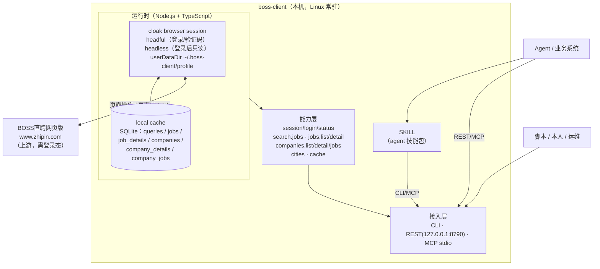

# boss-client 需求文档（PRD）

| 项 | 内容 |
| --- | --- |
| 版本 | v0.1（草稿，待评审） |
| 日期 | 2026-11-11 |
| 状态 | 草稿 → 评审中 |
| 关联文档 | [00 访谈记录](./00-需求访谈记录.md)、[02 接口草案](./02-接口草案.md)、[实测记录](../exploration/2026-11-11/REPORT.md) |
| 一句话定位 | 在本机常驻一个“cloak 浏览器 + BOSS直聘网页版”的只读客户端，复用独立 profile 保活登录态，把岗位搜索、岗位详情、公司列表、公司详情、公司职位、状态能力以 CLI / REST / MCP / SKILL 四种形态暴露给 Agent 与其他业务系统。 |

---

## 导航

- [1. 背景与目标](#1-背景与目标)
- [2. 术语](#2-术语)
- [3. 用户与场景](#3-用户与场景)
- [4. 总体架构](#4-总体架构)
- [5. 功能需求](#5-功能需求)
- [6. 非功能需求](#6-非功能需求)
- [7. 接口摘要](#7-接口摘要)
- [8. 数据模型（摘要）](#8-数据模型摘要)
- [9. 缓存设计](#9-缓存设计)
- [10. 里程碑](#10-里程碑)
- [11. 验收标准](#11-验收标准)
- [12. 风险与开放问题](#12-风险与开放问题)
- [附录 A：决策记录](#附录-a决策记录)
- [附录 B：实测证据](#附录-b实测证据)

> 本文是实现前的 PRD；当前实现以 `src/` + `spec/` 为准。阅读顺序建议：README → 03 部署 → 02 接口 → 本文。

## 1. 背景与目标

### 1.1 背景

- BOSS直聘是招聘平台，但**没有可直接使用的开放 API**；日常只能人工搜索岗位、翻页、打开岗位/公司详情。
- 实际业务用法：按「外贸 / 国际贸易 / 海外销售 / 单证 / 跟单」等关键词搜岗位 → 找到正在招这类岗位的公司 → 看公司详情/工商信息 → 形成销售线索。
- 本机已有环境：
  - `~/cloak-env`：共享 FHS + cloakbrowser 0.6.5 + Chromium 146（无 license key，keyless 免费档）。
  - `fuma-sales-dsh`：已有 BOSS直聘只读 CLI（2026-10-24 实测），但它是销售 Agent 工作区的一部分，不是独立客户端。
  - `tanji-client`：同机已有的“cloak 浏览器 + 本地缓存 + CLI/REST/MCP/SKILL”客户端，是本期工程的参照。
- 2026-11-11 已用非无头 cloakbrowser 真实跑通：二维码获取、短信验证码、极验点选、登录、岗位搜索、翻页、岗位详情、公司详情、公司全部职位、公司频道、状态检查。详见 [实测记录](../exploration/2026-11-11/REPORT.md)。

### 1.2 目标（v1）

1. **会话保活**：单账号、独立 profile 常驻；重启进程复用登录态；心跳检测；失效时给出明确的人工恢复路径。
2. **能力接口化**：把「岗位搜索、翻页、岗位详情、公司列表（去重）、公司详情（含工商信息）、公司全部职位、状态」封装为稳定接口。
3. **多形态对外**：CLI、本地 REST、MCP server、agent SKILL 四种形态，返回结构一致。
4. **本地结构化缓存**：SQLite 缓存岗位/公司/详情/查询，降低重复请求与风控风险；只存结构化数据，不存 raw 响应。
5. **登录可中继**：支持二维码（CLI 渲染 / REST Base64）与短信验证码；验证码截图、点击坐标、短信码可通过 REST 交给远程 agent/人完成。
6. **可运维**：Linux + systemd 常驻；结构化日志；`status` 一眼看到登录态、会话剩余时间、风控冷却、请求计数。

### 1.3 非目标（v1 明确不做）

| 不做 | 说明 |
| --- | --- |
| 官方 API / 开放平台 | 纯浏览器自动化，不依赖 BOSS 官方 API |
| 写操作 | 不沟通、不投递、不改简历、不切换招聘者身份、不收藏、不关注 |
| 候选人 / 简历数据 | 只读岗位与公司侧公开信息，不读候选人简历 |
| 公司大全频道 `/gongsi/` | v1 不做；company list 只来自岗位搜索结果去重 |
| 高级筛选 | v1 不做薪资/经验/学历/行业/规模/融资阶段筛选；只做关键词 + 城市 + 分页 |
| 多账号 | v1 单账号；架构预留 |
| Web 控制台 | 不做；只保留 CLI + REST + MCP |
| 文件导出 | 不落 CSV/Excel/PDF；只返回 JSON |
| raw 归档 / 证据链 | 用户明确只保留结构化缓存；不落 raw 响应/HTML |
| CRM 写入 | 不直接写 CRM / lead platform；由调用方消费 |
| 代理 IP | v1 不内置；配置位预留 |
| 自动破解验证码 | 不做；极验由人工/外部 agent 完成 |
| 全自动首次登录 | 不承诺；首次/掉线需人工一次 |

---

## 2. 术语

| 术语 | 含义 |
| --- | --- |
| boss-client | 本文档描述的本机客户端（Node.js 常驻进程） |
| cloak browser session | 用 cloakbrowser 启动的持久化浏览器上下文，承载 BOSS 登录态 |
| profile | Chromium userDataDir，默认 `~/.boss-client/profile` |
| jobId | `encryptJobId`，用于 `/job_detail/<jobId>.html` |
| securityId | 岗位详情 API 使用的短时效令牌；从搜索结果或岗位页 JS 中取得 |
| lid | 岗位列表返回的检索会话标识；详情 API 兼容参数 |
| companyId | `encryptBrandId`，用于 `/gongsi/<companyId>.html` 与 `/gongsi/job/<companyId>.html` |
| USCC | 统一社会信用代码（公司页 DOM 文本提取） |
| queryId | 一次搜索的服务端查询 ID，用于翻页/公司聚合 |
| status | 综合状态：登录态 + 会话剩余时间 + 风控冷却 + 请求计数 + 缓存统计；无额度 |
| login relay | 登录中继：REST 返回二维码/验证码信息，提交点击坐标/短信码 |
| code37 | BOSS 风控返回 `code=37 环境存在异常` |
| SKILL | agent 技能包；内部通过 CLI 或 MCP 调用本客户端 |

---

## 3. 用户与场景

### 3.1 角色

| 角色 | 描述 | 使用方式 |
| --- | --- | --- |
| Agent（主） | Claude Code / Codex / DSH 等 agent | SKILL / MCP |
| 其他业务系统 | fuma-sales-dsh、lead platform、CRM 同步任务等 | REST（127.0.0.1 + Bearer） |
| 脚本 / 本人 / 运维 | 临时查询、调试、登录恢复 | CLI / `status` |

### 3.2 用户故事

| ID | 故事 | 验收要点 |
| --- | --- | --- |
| US-01 | 作为使用者，我希望客户端开机自启、长期在线，不需要每天重新登录 | 冷启动复用 profile；心跳；失效提示 |
| US-02 | 作为使用者，我想知道现在能不能查、会话还剩多久、是否在风控冷却 | `status` 返回登录态、会话剩余、冷却 |
| US-03 | 作为 agent，我想按关键词 + 城市搜索岗位 | `search.jobs` 返回岗位 + 分页 |
| US-04 | 作为 agent，我想按页拿更多岗位 | `jobs.list` 按 queryId 翻页；`page` 有效 |
| US-05 | 作为 agent，我想看某个岗位的详情 | `jobs.detail` 返回描述、技能、招聘者、公司摘要 |
| US-06 | 作为 agent，我想拿到这次搜索命中的公司去重列表 | `companies.list` 按 companyId 去重，含岗位数 |
| US-07 | 作为 agent，我想看公司详情和完整工商信息 | `companies.detail` 返回工商字段 + 热招 + 招聘者 |
| US-08 | 作为 agent，我想看某公司在招的全部岗位 | `companies.jobs` 返回全部职位 |
| US-09 | 作为使用者，我希望重复查询不要反复打上游 | 缓存命中 `cached=true` |
| US-10 | 作为 agent，我希望 CLI/REST/MCP 返回同一 schema | 三通道同构 |
| US-11 | 作为远程 agent/运维，我想在无头服务器上完成登录 | REST 中继 QR/验证码/短信码 |
| US-12 | 作为使用者，我想用技能包完成“搜外贸 → 公司列表 → 详情 → 汇总” | SKILL 示例跑通 |

---

## 4. 总体架构

### 4.1 架构图



### 4.2 组件职责

| 组件 | 职责 | 关键约束 |
| --- | --- | --- |
| cloak browser session | 启动/守护持久化浏览器；登录；页面内 fetch；DOM 提取 | 单实例；独立 profile；headful 登录、headless 只读 |
| 会话管理器 | 心跳、登录态检测、会话剩余时间、失效标记 `needs_human`、风控冷却 | 不自动破解验证码；重试有上限 |
| 登录中继 | QR 抽取/Base64、验证码截图/点击坐标、短信码提交 | loginId 短 TTL；仅 loopback + Bearer；不写日志 |
| 能力层 | 把页面/API 操作翻译成领域操作（搜索/列表/详情/公司） | 上游结构集中配置；改版只改一处 |
| local cache | 岗位/公司/详情/查询缓存与去重 | SQLite；TTL；只存结构化数据 |
| 接入层 | CLI / REST / MCP 三通道 + SKILL | 返回统一 schema；REST 仅 127.0.0.1 + Bearer |
| SKILL | agent 技能包，编排典型业务流程 | 不直接操作浏览器，只调 CLI/MCP |

### 4.3 主数据流

```
agent/业务系统
  → status 预检（登录态、会话剩余、冷却）
  → 不通过 → login（QR/SMS，人工/中继）
  → search.jobs（缓存未命中才请求上游）
  → jobs.list 翻页 / companies.list 去重
  → jobs.detail / companies.detail / companies.jobs
  → 统一 JSON 返回（CLI/REST/MCP 同构）
```

---

## 5. 功能需求

### FR-1 会话保活与登录（核心）

| 项 | 需求 |
| --- | --- |
| 浏览器 | 复用 `~/cloak-env`（cloakbrowser 0.6.5 + Chromium 146）；`launchPersistentContext({ userDataDir })`；独立 profile |
| 登录方式 | **二维码**（headless 默认/推荐） 与 **短信验证码**（需 headful）两种；不支持账号密码 |
| 登录形态 | 二维码可在 headless 下抽取 Base64 扫码；短信/极验阶段需 headful；无 DISPLAY 的服务器可用 Xvfb |
| 首次登录 | 人工介入一次；客户端提供 QR 渲染/Base64、验证码截图/点击、短信码提交 |
| 会话检测 | 心跳（默认 5 分钟）：`GET /wapi/zpuser/wap/getUserInfo.json`，`code=0` 且 `zpData.userId` 存在即已登录 |
| 会话剩余 | 从 `wt2/zp_at` cookie 到期时间估算；`status.session.expiresAt/remainingSec` |
| 失效处理 | 置 `health=needs_human`；`status`/日志给出原因；不反复重试打爆风控 |
| 单实例 | 文件锁 + profile 互斥；禁止同机双开 |
| 登录并发 | 同一时刻只允许 1 个 loginId；TTL 10 分钟；超时/取消后释放 |
| 人工恢复 | `boss login --sms|--qr`（headful）；REST 中继（见 FR-13） |
| 进程守护 | systemd `Restart=always`；崩溃重启后复用 profile |

**边界情况**
- 验证码失败：返回新的验证码 challenge；不无限重试；连续失败置 `needs_human`。
- 短信频控：返回 `SMS_RATE_LIMITED`，提示等待；不重复点发送。
- 二维码过期：`qr.expiresAt`；客户端应刷新 QR；页面自身会刷新。
- 账号被风控/异常：`UPSTREAM_BLOCKED` / `needs_human`；不反复登录。
- 网络中断：保持 profile；退避重试；恢复后自动续上。
- BOSS 改版：`UPSTREAM_CHANGED`，日志输出失效选择器/接口。

### FR-2 status（合并 check status）

一次调用返回：

| 字段 | 说明 |
| --- | --- |
| `loggedIn` | 是否已登录 |
| `health` | `ok` / `degraded` / `needs_human` / `cooldown` / `logged_out` |
| `account` | 账号标识（手机号脱敏、显示名脱敏、`isHunter`） |
| `session` | `profileDir`、`startedAt`、`lastCheckedAt`、`expiresAt`、`remainingSec` |
| `risk` | `cooldownUntil`、`code37Count`、`lastError` |
| `requests` | `today`、`cacheHits`、`cacheMisses`、`lastUpstreamAt` |
| `cache` | `dbPath`、`sizeBytes`、`entries` |
| `warnings` | 非致命告警（会话即将过期、缓存过期等） |

- 该接口只读；不额外消耗查询额度。
- **没有 quota 字段**（BOSS 求职者侧无探迹式额度）。
- `check status` 与 `status` 合并，不再单独提供。

### FR-3 search.jobs（岗位搜索）

- 输入：`keyword`（必填）、`cityCode`（默认取配置，多城市可配）、`page`（默认 1）、`pageSize`（默认 15，1–100）、`pages`（1–5，默认 1）。
- 行为：优先 `search.jobs` 直接请求 API（页面内 fetch）；返回 `queryId`、`jobs`、`companies`（本次已抓取页的去重公司）、分页信息。
- 缓存：同一 `(keyword, cityCode, page, pageSize)` 2 小时内命中；`refresh=true` 绕过。
- 上游：`POST /wapi/zpgeek/search/joblist.json`；页面先导航到搜索页建立同源上下文。
- `resCount` 与 `totalCount` 不同：`totalCount` 可能是展示上限（实测 300），不能当全集。
- 错误：`code 37` → `UPSTREAM_BLOCKED`；进入冷却；重试 1 次后仍失败则返回错误。
- v1 不支持高级筛选；`salary/experience/degree/industry/scale/stage` 保留内部字段，不对外暴露。

### FR-4 jobs.list（按 queryId 翻页）

- 输入：`queryId`、`page`、`pageSize`、`refresh`。
- 行为：按 queryId 取搜索条件；请求对应页；写入/更新缓存；返回岗位列表 + 分页。
- 与 `search.jobs` 共用 `queryId` 与缓存；`page` 从 1 开始。
- `queryId` 过期（默认 24h）→ `QUERY_EXPIRED`。
- 单次调用只请求 1 页；页间由服务端限频/延迟控制，避免连续 5 页触发 code37。

### FR-5 jobs.detail（岗位详情）

- 输入：`jobId` 或 `securityId`；可选 `lid`、`refresh`。
- 行为：
  - 有 `securityId` → 直接 `GET /wapi/zpgeek/job/detail.json?securityId=...`。
  - 只有 `jobId` → 打开 `/job_detail/<jobId>.html`，从页面 JS/DOM 提取 `securityId`，再请求详情 API。
- 输出：岗位详情 + 招聘者 + 公司摘要（`brandComInfo`）。
- 缓存：默认 12h；`refresh=true` 绕过。
- 错误：岗位不存在/已关闭 → `NOT_FOUND`；`code 37` → `UPSTREAM_BLOCKED`。

### FR-6 companies.list（搜索结果去重公司）

- 输入：`queryId`、`page`、`pageSize`、`fetchPages`（0–5，默认 0）、`refresh`。
- 行为：从 queryId 已抓取的岗位结果中按 `companyId=encryptBrandId` 去重；`fetchPages>0` 时先抓取额外页再聚合。
- 输出：公司摘要列表（含 `jobCount`、`matchedJobs`（最多 10 条）、城市/行业/规模/融资阶段、首次/最近出现时间）。
- 分页：对去重后的公司列表分页；`meta.pagination` 给出 `total`、`pagesFetched`、`pagesAvailable`。
- 缓存：公司摘要 7 天；岗位命中时间随查询缓存更新。

### FR-7 companies.detail（公司详情，含工商信息）

- 输入：`companyId`（`encryptBrandId`）、`refresh`。
- 行为：打开 `/gongsi/<companyId>.html`；从 SSR DOM 提取公司资料 + 工商信息 + 热招职位 + 招聘者 + 福利。
- 输出：`CompanyDetail`（见接口草案），其中 `business` 含 USCC/法人/注册资本/成立时间/经营范围等；`business.usccSource='boss_company_page_text'`、`textDerived=true`。
- 缓存：默认 7 天；`refresh=true` 绕过。
- 备注：`companies.detail` 返回热招（最多 10 条）+ `jobCount`；全部职位由 `companies.jobs` 提供。

### FR-8 companies.jobs（公司全部在招职位）

- 输入：`companyId`、可选 `refresh`。公司职位页当前一次返回全部职位；如后续出现分页再扩展 `page/pageSize`。
- 行为：打开 `/gongsi/job/<companyId>.html`；从 SSR DOM/内嵌 JS 提取全部职位；若页面内嵌 `securityId`，一并返回。
- 输出：`CompanyJob[]`；每条含 jobId、标题、薪资、经验、学历、城市/区域、招聘者、jobUrl。
- 缓存：默认 2h；`refresh=true` 绕过。
- 说明：公司职位页可能因公司规模/APP 限制只展示部分；在 `meta.warnings` 标注 `truncated`。

### FR-9 cities.list（城市注册表）

- 输出：`cityCode` / `cityName` / `province` / `isDefault` 列表。
- 来源：内置常用城市 + 从 BOSS 城市接口刷新（`/wapi/zpCommon/data/cityGroup.json` 等）。
- 缓存：7 天；`refresh` 可刷新。
- 用途：多城市配置、CLI `--city` 校验、避免中文城市名直接拼 URL。

### FR-10 本地缓存

| 项 | 约定 |
| --- | --- |
| 存储 | SQLite 单文件，默认 `~/.boss-client/cache.db`；WAL；单写者 |
| 表 | `queries`、`jobs`、`job_details`、`companies`、`company_details`、`company_jobs`、`meta` |
| TTL | 岗位列表 2h、岗位详情 12h、公司详情 7d、公司全部职位 2h、queryId 24h（均可配） |
| 去重键 | 岗位 `jobId`；公司 `companyId`；查询 `queryId` |
| 失效 | `boss cache clear --all` / `--prefix` / `--expired` |
| 观测 | `meta.cached`、缓存命中计数写入日志 |
| 不存 | raw 响应/HTML、cookie/token/验证码、完整手机号 |

### FR-11 接入形态

| 形态 | v1 范围 | 说明 |
| --- | --- | --- |
| CLI | 全量能力 | 默认 JSON；`--format table` 可选 |
| REST | 全量能力 | `127.0.0.1:8790`，Bearer；见接口草案 |
| MCP server | 全量能力 | stdio；工具名 `boss_*` |
| SKILL | 示例技能包 | “搜外贸 → 公司列表 → 详情 → 汇总” |

**一致性要求**：同一能力在 CLI/REST/MCP 下返回同一 JSON schema。

### FR-12 日志与可观测

- JSON Lines，字段：`ts`、`level`、`requestId`、`op`、`cached`、`upstreamMs`、`errorCode`、`message`。
- 默认写 `~/.boss-client/logs/boss.log`（滚动），同时 stdout 供 systemd/journald。
- 脱敏：手机号、验证码、cookie、token、二维码内容、`securityId`（日志中截断/哈希）。
- `status` 是面向人的体检入口；日志是排障入口。
- 风控事件（code37、captcha 失败、SMS 频控）单独 warn 日志。

### FR-13 登录中继（REST）

- `POST /v1/session/login`：`{mode?:'sms'|'qr', phone?}`；缺省按配置选择（headless→qr / 否则 sms）；返回 `loginId`、`state`、`expiresAt`，以及：
  - QR：`qr.pngBase64`（200×200）、`qr.expiresAt`；
  - SMS：手机号掩码；若出现验证码，返回 `captcha`（kind、screenshotBase64、image 尺寸、prompt）；
  - 若无需验证码，`state=awaiting_sms_code`。
- `POST /v1/session/login/{loginId}/captcha`：`{kind:'click', points:[{x,y}...]}` 或 `{kind:'slider', offsetPx}`；返回新 state；失败返回 `CAPTCHA_INVALID` + 新的 captcha 信息。
- `POST /v1/session/login/{loginId}/sms`：`{code:'123456'}`；返回 state；可能需要再次 captcha。
- `GET /v1/session/login/{loginId}`：查询状态；QR 模式可返回刷新后的 Base64。
- `DELETE /v1/session/login/{loginId}`：取消。
- 约束：loginId 随机、TTL 10 分钟、单活跃登录、仅 loopback+/v1 + Bearer；二维码/验证码截图不落长期磁盘、不写日志；`securityId`/cookie 不回显。
- CLI 对应：`boss login --sms` / `--qr`；默认打开 headful 窗口；`--relay` 走 REST 中继。二维码在 CLI 直接渲染（优先 `qrcode-terminal` 类库 + ANSI；无法渲染时打印文件路径）。

---

## 6. 非功能需求

| 类别 | 要求 |
| --- | --- |
| 稳定性 | 7×24 常驻；单实例；崩溃自动重启；掉线不轰炸登录；长时间运行内存无明显增长 |
| 性能 | 缓存命中响应 < 50ms；未命中以页面/接口实际为准；单次请求超时默认 30s |
| 并发 | 单账号对上游串行；接口层可排队；同一时刻只允许 1 个上游请求 |
| 限频 | 默认 12 次/分；页间 2.5–4s 抖动；单次任务 ≤5 页；code37 → 冷却 60s + 重试 1 次 |
| 安全 | REST 仅 `127.0.0.1` + Bearer；profile/cache/log 权限 600/700；手机号/验证码/token 脱敏；登录中继仅本机 |
| 兼容 | Linux（systemd）；Node.js ≥22.5（与 tanji 一致）；cloakbrowser 0.6.5；NixOS 走 FHS |
| 可维护 | 站点 URL/选择器/接口集中配置；改版只改一处；关键路径有测试 |
| 合规 | 仅本人/授权账号；低频只读；不做账号共享/批量导流；遵守 BOSS 服务条款 |

---

## 7. 接口摘要

详细见 [02 接口草案](./02-接口草案.md)。

- 统一 envelope：`{ ok, data, meta:{schemaVersion, requestId, timestamp, tookMs, cached, pagination?, warnings, upstream?}, error }`
- 错误码：`AUTH_REQUIRED`、`SESSION_EXPIRED`、`HEADFUL_REQUIRED`、`CAPTCHA_REQUIRED`、`CAPTCHA_INVALID`、`SMS_CODE_REQUIRED`、`SMS_CODE_INVALID`、`SMS_RATE_LIMITED`、`RATE_LIMITED`、`UPSTREAM_BLOCKED`、`UPSTREAM_CHANGED`、`UPSTREAM_UNAVAILABLE`、`SERVICE_UNAVAILABLE`、`TIMEOUT`、`NOT_FOUND` 等。
- 核心操作：`status.get`、`session.login.*`、`search.jobs`、`jobs.list`、`jobs.detail`、`companies.list`、`companies.detail`、`companies.jobs`、`cities.list`、`cache.stats`、`cache.clear`。

---

## 8. 数据模型（摘要）

| 模型 | 关键字段 |
| --- | --- |
| `JobSummary` | jobId、securityId、title、salaryText、experience、degree、cityCode/cityName、district、companyId/companyName、industry/scale/stage、bossName/bossTitle/bossOnline、skills、welfare、jobUrl、firstSeenAt/lastSeenAt |
| `JobDetail` | JobSummary + description、jobStatusDesc、address、lat/lng、recruiter、company、fetchedAt |
| `CompanySummary` | companyId、name、industry、scale、stage、cityName、jobCount、matchedJobs、firstSeenAt/lastSeenAt |
| `CompanyDetail` | CompanySummary + fullName、logo、intro、tags、benefits、address、hotJobs、recruiters、business、jobCount、url、fetchedAt |
| `BusinessInfo` | companyName、legalRepresentative、foundedAt、companyType、businessStatus、registeredCapital、registeredAddress、businessTerm、region、uscc、approvalDate、registrationAuthority、formerNames、businessScope、usccSource、textDerived |
| `CompanyJob` | jobId、title、salaryText、experience、degree、cityName、district、recruiterName/Title、jobUrl |
| `SearchQuery` | queryId、keyword、cityCode、cityName、pageSize、pagesFetched、resCount、totalCount、hasMore、fetchedAt |
| `Status` | loggedIn、health、account、session、risk、requests、cache、warnings |
| `LoginSession` | loginId、mode、state、phoneMasked、qr/captcha、expiresAt、message |

---

## 9. 缓存设计

| 表 | 主键 | 内容 | 默认 TTL |
| --- | --- | --- | --- |
| `queries` | queryId | 关键词、城市、分页、resCount/totalCount/hasMore、已抓页 | 24h |
| `jobs` | jobId | JobSummary + securityId/lid + 所属 queryId | 2h |
| `job_details` | jobId | JobDetail JSON | 12h |
| `companies` | companyId | CompanySummary + matchedJobIds | 7d |
| `company_details` | companyId | CompanyDetail JSON（含工商信息） | 7d |
| `company_jobs` | companyId + jobId | CompanyJob JSON | 2h |
| `meta` | key | schemaVersion、lastLoginAt、lastStatus、counters | — |

- 所有读取接口支持 `refresh=true` 绕过 TTL；`meta.cached` 标识是否命中。
- `cache.clear` 支持 `--all` / `--prefix` / `--expired`。
- 不存 raw 响应；不存 cookie/token/验证码；不存完整手机号。

---

## 10. 里程碑

| 里程碑 | 内容 | 预估 |
| --- | --- | --- |
| M0 | 工程脚手架（TS + lint + 测试）、cloak 启动、独立 profile、登录中继（QR/SMS/captcha）、`status` | 2–3 天 |
| M1 | `search.jobs` + `jobs.list` + SQLite 查询/岗位缓存 + `cities.list` | 2–3 天 |
| M2 | `jobs.detail` + `companies.list` + `companies.detail` + `companies.jobs` | 2–3 天 |
| M3 | CLI + REST + MCP + SKILL + OpenAPI/JSON Schema 生成 | 2–3 天 |
| M4 | systemd 部署 + 7 天稳定性观察 + 验收 | 1 周观察 |

> 工期依赖 BOSS 页面/接口稳定性；改版风险见第 12 节。

---

## 11. 验收标准

| ID | 验收项 |
| --- | --- |
| AC-1 | 冷启动（profile 有效）后无人工介入即可查询 |
| AC-2 | 杀死进程/重启服务后，复用 profile，无需重新登录 |
| AC-3 | 会话失效时 `status.health=needs_human` 且有明确原因/恢复路径；人工重登后恢复 |
| AC-4 | `status` 返回登录态、会话剩余时间、风控冷却、请求计数；无 quota 字段 |
| AC-5 | `search.jobs` 返回岗位与分页；`page=2` 正常；同条件二次调用命中缓存 |
| AC-6 | `companies.list` 按 companyId 去重；同一公司多岗位只出现一次，`jobCount` 正确 |
| AC-7 | `jobs.detail` 返回岗位描述/技能/招聘者/公司摘要；字段完整 |
| AC-8 | `companies.detail` 返回完整工商信息（USCC/法人/注册资本/经营范围等）与热招职位 |
| AC-9 | `companies.jobs` 返回公司全部在招职位 |
| AC-10 | 同一操作在 CLI/REST/MCP 三通道返回结构一致 |
| AC-11 | 登录中继可用：QR Base64、验证码截图+点击坐标、短信码提交；远程可完成登录 |
| AC-12 | 单实例约束生效；同机重复启动被拒绝 |
| AC-13 | 只读：全程不触发沟通/投递/简历/招聘者切换 |
| AC-14 | code37 触发时进入冷却并返回 `UPSTREAM_BLOCKED`，不无限重试 |

---

## 12. 风险与开放问题

### 12.1 风险

| 风险 | 影响 | 缓解 |
| --- | --- | --- |
| BOSS 改版 / DOM 变化 | 搜索/公司页解析失败 | URL/选择器集中配置；`UPSTREAM_CHANGED`；健康检查；快速修复 |
| 极验升级/策略变化 | 登录失败 | headful + 中继；人工兜底；不自动破解 |
| 会话到期/被踢 | 不可用 | 心跳、剩余时间告警、`needs_human`、人工重登 |
| 短信频控/费用 | 发码失败 | 限制发送频率；错误码 `SMS_RATE_LIMITED`；不重复发 |
| code37 风控 | 采集中断 | 单并发、页间延迟、单任务 ≤5 页、冷却 |
| 登录中继泄露 | 账号风险 | loopback + Bearer；短 TTL；不落长期盘；不写日志 |
| `totalCount` 展示上限 | 误判全集 | 以 `resCount` + `hasMore` 为准；不承诺全集 |
| 无发布时间 | 时效判断缺失 | `first_seen_at/last_seen_at`；公司职位页更新时间辅助 |
| 工商信息为 DOM 文本 | 字段可能缺失/变格式 | `textDerived=true`；字段空值不报错；调用方复核 |
| 合规/ToS | 账号风险 | 仅本人授权账号、低频只读、不做共享/导流 |

### 12.2 开放问题

1. `securityId` 是否在 `JobSummary` 中直接暴露（推荐是；同时支持 `jobId` 从岗位页解析）。
2. `companies.detail`：已按「热招（最多 10 条）+ `companies.jobs` 全部职位」设计，评审确认该拆分。
3. 缓存 TTL 默认值是否合适（岗位 2h / 岗位详情 12h / 公司详情 7d / 公司职位 2h）。
4. 会话剩余 <24h 时是否置 `degraded` 并 warning（推荐是）。
5. 登录中继是否需要“验证码截图落盘”模式（默认只内存/临时文件，TTL 删除）。
6. `companies.jobs` 的分页：公司职位页当前一次展示全部；如遇大公司需确认 BOSS 是否截断/需滚动。
7. 登录后是否切换 headless：fuma 既有结论 headless 可用；本期默认登录/验证码 headful、只读 headless，M0 复验。

---

## 附录 A：决策记录

| 决策 | 结论 |
| --- | --- |
| 项目定位 | 独立 boss-client；与 fuma boss CLI 不冲突；对标 tanji-client |
| 数据用途 | 招聘信号 → 公司线索；只读；不写 CRM |
| 接入方式 | 纯浏览器自动化；不依赖官方 API |
| 登录 | QR + SMS；默认 SMS；首次/掉线人工一次；REST 中继（C） |
| 能力 | search.jobs / jobs.list / jobs.detail / companies.list / companies.detail / companies.jobs / status / cities / cache |
| company list | 岗位搜索结果按 encryptBrandId 去重；不做 `/gongsi/` 目录 |
| status | 登录态 + 会话 + 风控冷却 + 计数 + 缓存；无额度 |
| 接口 | CLI + REST + MCP + SKILL；端口 8790；127.0.0.1 + Bearer；systemd |
| 缓存 | SQLite 结构化缓存；不落 raw |
| 账号 | 单账号；多城市可配；v1 不做高级筛选 |
| 浏览器 | 复用 cloak-env；独立 profile `~/.boss-client/profile` |

## 附录 B：实测证据

- [2026-11-11 实测记录](../exploration/2026-11-11/REPORT.md)
- `exploration/2026-11-11/artifacts/network.jsonl`（942 行请求/响应）
- `exploration/2026-11-11/artifacts/navigations.jsonl`（61 行页面顺序）
- `exploration/2026-11-11/artifacts/responses/`（388 个响应体）
- `exploration/2026-11-11/artifacts/screenshots/`（27 张截图）
