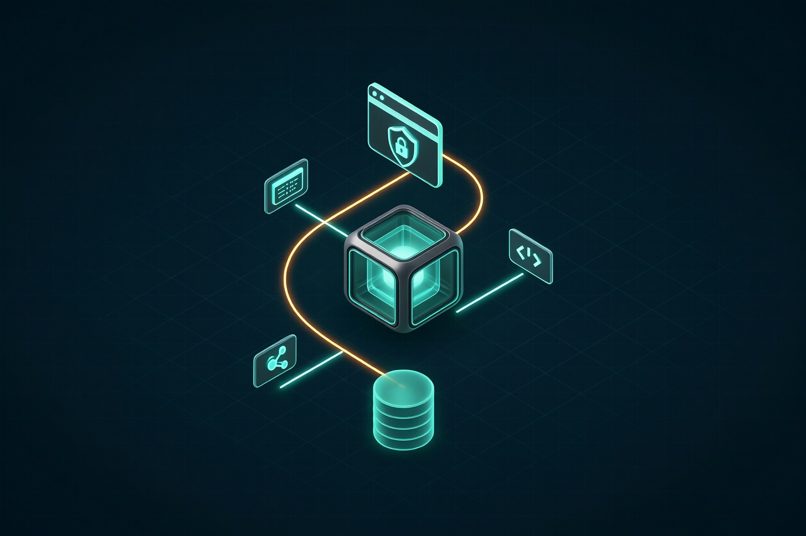

# boss-client 环境配套

<div align="center">
  
  <h4>共享 FHS / 独立 profile / 可选 DISPLAY</h4>
</div>

> 本文说明 `boss-client` 依赖的共享 cloak 环境、Node/FHS、独立 profile、DISPLAY/Xvfb、权限与版本约束。

---

## 目录

- [1. 组件关系](#1-组件关系)
- [2. 版本](#2-版本)
- [3. 为什么需要 FHS](#3-为什么需要-fhs)
- [4. 安装/检查 cloak-env](#4-安装检查-cloak-env)
- [5. profile 与登录态](#5-profile-与登录态)
- [6. DISPLAY / Xvfb](#6-display--xvfb)
- [7. 权限](#7-权限)
- [8. 版本升级策略](#8-版本升级策略)
- [9. 常见问题](#9-常见问题)
- [10. MCP 与常驻服务](#10-mcp-与常驻服务)
- [11. 最小验证](#11-最小验证)

> 一句话：**FHS 和浏览器二进制共享，profile 必须按项目独立；headful 只用于短信/极验登录，二维码可 headless。**

## 1. 组件关系

```text
~/cloak-env/                 共享环境（项目外部，多个客户端共用）
├── fhs.nix                  FHS 构建表达式
├── cloak-fhs -> /nix/store/...  FHS 根（GC root）
├── package.json             cloakbrowser 0.6.5 + playwright-core 1.65.0
├── node_modules/
├── bin/cloak-run            进入 FHS 后执行命令
└── bin/cloak-env-info       版本/路径信息

~/boss-client/               本项目
├── bin/boss-run             通过 cloak-run 运行 dist/main.js
├── dist/                    tsc 产物
├── spec/                    生成物
└── .env                     本项目配置（600）

~/.boss-client/              本项目运行时数据（独立于 tanji/fuma）
├── profile/                 Chromium userDataDir（登录态）
├── cache.db                 SQLite 结构化缓存
├── logs/boss.log            JSONL 日志
├── run/boss.lock            单实例锁
└── session.json             storage state（可选，600）
```

**关键原则**：FHS/浏览器二进制共享，**profile 必须每个项目独立**；本项目的 profile 不与 `~/.tanji-client/profile`、`fuma-sales-dsh/runtime/browser-profiles/*` 共用。

---

## 2. 版本

| 组件 | 版本 | 说明 |
| --- | --- | --- |
| cloakbrowser | **0.6.5** | 0.6 线最后 keyless 版本；0.7.x 起需要 license key |
| playwright-core | **1.65.0** | 与 cloakbrowser 匹配 |
| Chromium | 146.0.7680.177.5 | 缓存在 `~/.cloakbrowser`，用户级共享 |
| FHS Node | 22.23.2 | `cloak-run` 内使用 |
| 项目 Node | ≥ 22.5 | `node:sqlite` 需要 |

```bash
~/cloak-env/bin/cloak-env-info
```

---

## 3. 为什么需要 FHS

NixOS 默认没有 FHS 的 `/lib64/ld-linux-x86-64.so.2` 等路径；cloakbrowser 的 Chromium 是通用 Linux 二进制，直接在 NixOS 主环境启动会缺动态库。`cloak-env/fhs.nix` 构建一个 FHS 兼容根，`bin/cloak-run` 进入该根再执行 Node/Chromium。

因此：

- **项目运行**：`bin/boss-run` → `~/cloak-env/bin/cloak-run node dist/main.js`
- **开发/测试**：`npm test` / `npm run build` 不启动浏览器，可在主环境执行
- **只有启动浏览器**（`status`/`login`/`search`/`detail`）才需要 cloak-run

---

## 4. 安装/检查 cloak-env

若本机已有 `~/cloak-env`：

```bash
~/cloak-env/bin/cloak-env-info
# cloakbrowser 0.6.5
# playwright-core 1.65.0
```

若没有，需要按 cloak-env 的项目说明构建 FHS（NixOS）：

```bash
cd ~/cloak-env
NIXPKGS_ALLOW_UNFREE=1 nix build --impure --expr 'import ~/cloak-env/fhs.nix' -o ~/cloak-env/cloak-fhs
```

> Chromium 首次启动会自动下载到 `~/.cloakbrowser`（约 200MB）；需要网络。

项目内通过 `CLOAK_ENV` 指定其他共享环境：

```bash
CLOAK_ENV=/opt/cloak-env boss status
```

---

## 5. profile 与登录态

- 默认：`~/.boss-client/profile`
- `launchPersistentContext({ userDataDir })`；登录 cookie/localStorage 都在 profile 内
- 独立 profile 的原因：避免与 tanji/fuma 的 BOSS 账号、cookie、单实例锁冲突
- 删除 profile 会丢失登录态（需重新扫码/短信），不会影响缓存
- 备份：停服务后复制 `~/.boss-client/profile` 与 `session.json`（含敏感登录态，注意权限）

---

## 6. DISPLAY / Xvfb

BOSS 的二维码登录可在 headless 下渲染并导出 Base64；短信/极验需要真实可视浏览器，`headful` 模式需要 DISPLAY：

- 桌面：`DISPLAY=:0`（Wayland 下 XWayland）
- 无桌面服务器：Xvfb

```bash
Xvfb :99 -screen 0 1440x900x24 &
export DISPLAY=:99
boss login
```

systemd 用户单元中：

```ini
Environment=DISPLAY=:99
ExecStartPre=/usr/bin/Xvfb :99 -screen 0 1440x900x24
```

登录成功后可设置 `BOSS_HEADLESS=true` 做只读查询；headless 下推荐用二维码登录，短信/极验仍需 headful 或 Xvfb。

---

## 7. 权限

| 路径 | 权限 |
| --- | --- |
| `~/.boss-client/` | 700 |
| `~/.boss-client/profile/` | 700 |
| `~/.boss-client/cache.db` | 600 |
| `~/.boss-client/logs/boss.log` | 600 |
| `.env` | 600 |
| `session.json` | 600 |

`bin/boss-run` 会 `cd` 到项目根；`.env` 由 `boss` 启动时自动加载（不覆盖已 export 的变量）。

---

## 8. 版本升级策略

- **不要把 cloakbrowser 升到 0.7.x**：需要 license key；本项目锁定 0.6.5。
- 升级 cloakbrowser 时同步修改 `package.json` 的精确版本，并跑 `npm test` + 一次 `boss status` 冒烟。
- 升级 FHS/Chromium 后重新执行 `~/cloak-env/bin/cloak-env-info`，确认路径仍有效。
- 项目依赖升级：`npm install` 后跑 `npm run typecheck && npm test && npm run build && npm run gen:check`。

---

## 9. 常见问题

| 问题 | 原因/处理 |
| --- | --- |
| `cloak-run: FHS not found` | `~/cloak-env/cloak-fhs` 不存在或被 GC；重建 FHS |
| `Cannot find package 'cloakbrowser'` | 不在 FHS 或 node_modules 缺失；用 `bin/boss-run`，`npm install` |
| `HEADFUL_REQUIRED` | 短信/极验无 DISPLAY；改用二维码，或桌面/Xvfb |
| profile 被锁 | 另一个 boss 进程占用；`pgrep -af boss`；必要时清 `~/.boss-client/run/boss.lock` |
| 浏览器启动即退出 | 检查 Chromium 二进制/`~/.cloakbrowser`、FHS、DISPLAY |
| 查询很慢/风控 | 降低 `BOSS_RATE_PER_MIN`、增大 `BOSS_PAGE_DELAY_MS`、单次 ≤5 页 |
| `node:sqlite` warning | Node 22 实验特性；不影响；可用 `BOSS_CACHE_DRIVER=memory` |

---

## 10. MCP 与常驻服务

`boss mcp` 默认是 **REST 代理**，不创建本地 App、不持有浏览器/profile；它通过 `BOSS_CLIENT_URL`（或自动探测 `127.0.0.1:<BOSS_PORT>`）调用常驻服务。只有显式 `boss mcp --local` 才会本地启动浏览器。

## 11. 最小验证

```bash
# 1) FHS/浏览器
~/cloak-env/bin/cloak-env-info

# 2) 项目
cd ~/boss-client
npm run typecheck
npm test
npm run build

# 3) 不启动浏览器
boss health
# 4) 启动浏览器 + 登录态
boss status
# 5) 只读查询
boss search jobs --keyword 外贸 --city 101090100
```

全部通过即环境配套完成。
